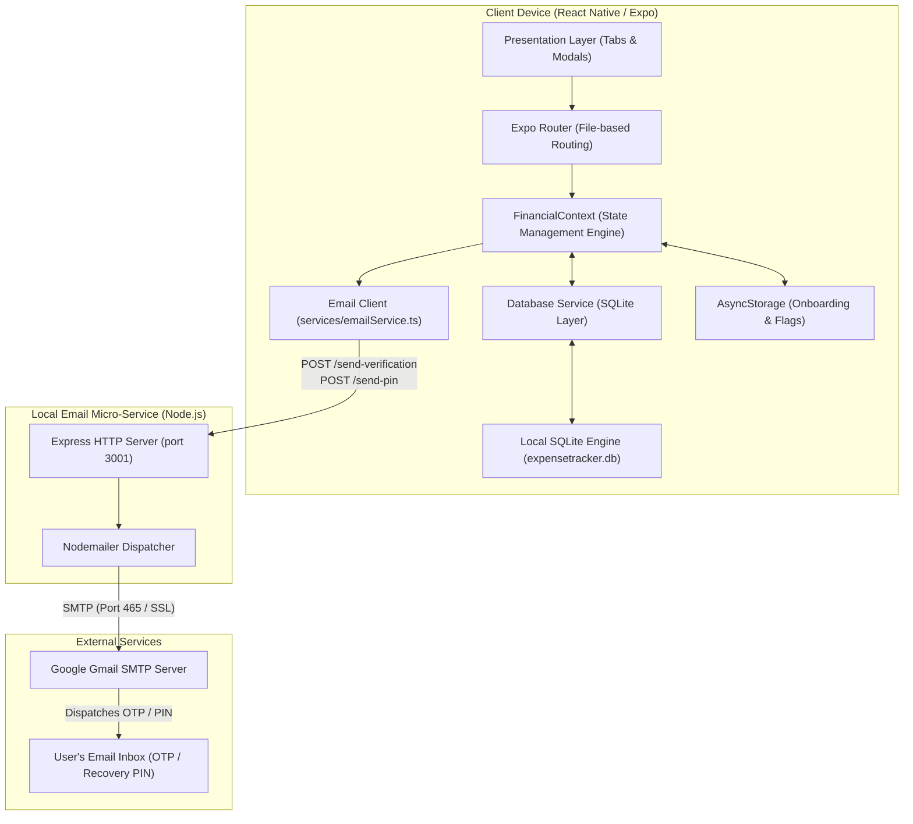
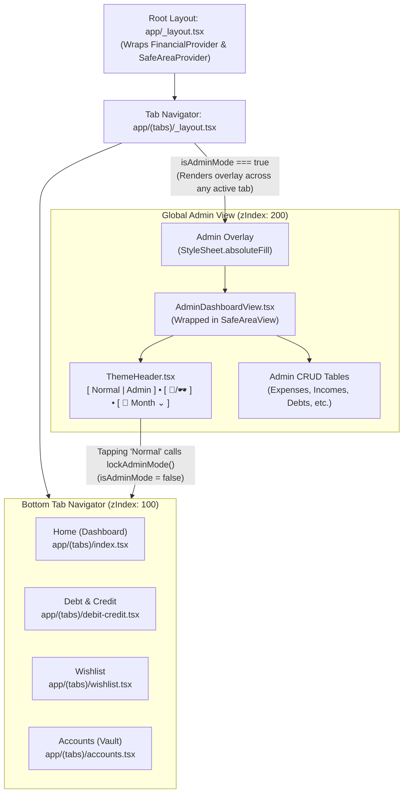
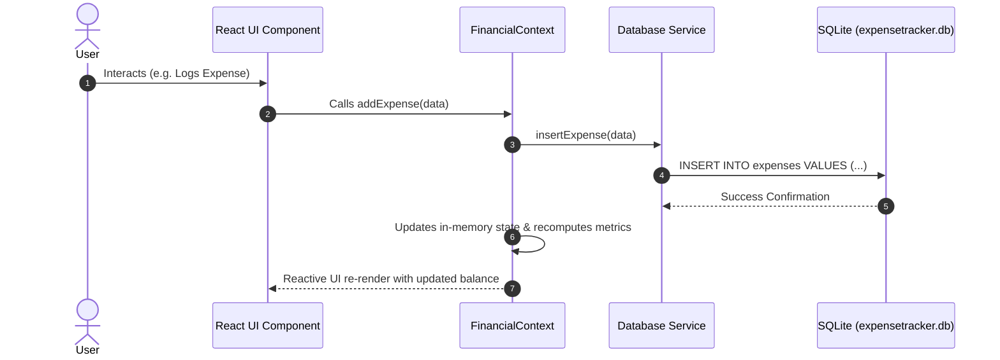
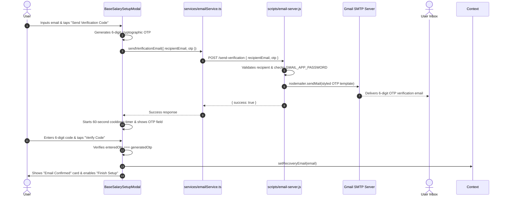
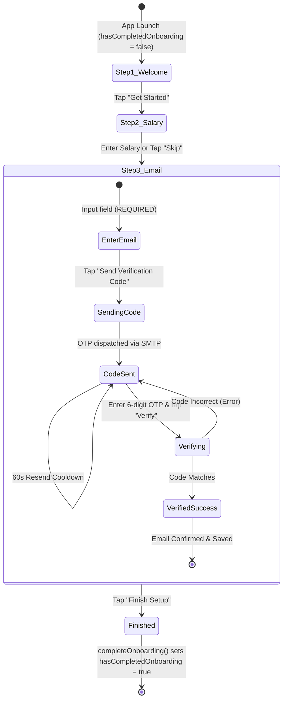

# 💸 Cashly — Project Documentation & Architecture

## Table of Contents
1. [Project Overview](#1-project-overview)
2. [System Architecture](#2-system-architecture)
   - [2.1 High-Level Architecture Diagram](#21-high-level-architecture-diagram)
   - [2.2 Navigation & Global Admin Overlay Architecture](#22-navigation--global-admin-overlay-architecture)
   - [2.3 State Management & Data Flow Architecture](#23-state-management--data-flow-architecture)
   - [2.4 Email Micro-Service Architecture](#24-email-micro-service-architecture)
3. [Tech Stack](#3-tech-stack)
4. [Project Structure](#4-project-structure)
5. [Data Models](#5-data-models)
6. [Database Schema](#6-database-schema)
7. [Screens & Navigation](#7-screens--navigation)
8. [Core Components](#8-core-components)
9. [State Management — FinancialContext](#9-state-management--financialcontext)
10. [Services & Micro-Services](#10-services--micro-services)
11. [Onboarding & Mandatory Email Verification](#11-onboarding--mandatory-email-verification)
12. [Theming System](#12-theming-system)
13. [Security & Access Control](#13-security--access-control)
14. [Environment Configuration](#14-environment-configuration)
15. [Available Scripts](#15-available-scripts)
16. [Reset & Recovery](#16-reset--recovery)

---

## 1. Project Overview

**Expense Tracker** is a production-grade personal finance management mobile application built with React Native and Expo. It provides comprehensive financial tracking across multiple categories: daily expenses, income logging, salary scheduling, debt/credit repayment logs, prioritized wishlists, cash envelope budgeting, and multi-account asset vaults.

All user data is stored locally on-device using SQLite with zero external database dependencies. The application features a dual-theme system (Kawaii Pastel 🌸 and Noir Monochrome 🕶️), a multi-layer PIN security architecture, global admin controls accessible across all tabs, and a dedicated email micro-service for OTP verification and PIN recovery.

### Key Features

| Feature | Description |
|---|---|
| 💰 Expense & Income Tracking | Log and categorize spending and incoming funds by month with real-time statistics |
| 🏦 Multi-Account Asset Vault | Track Cash, Bank, Wallet, Credit, and Savings accounts with PIN encryption |
| 📅 Salary & Payday Engine | Automates base salary logging, custom paydays, and per-month adjustments |
| 💳 Debt & Credit Ledger | Detailed borrowing and lending records with partial installment histories |
| 🎁 Prioritized Wishlist | Goal tracker with high/med/low urgency tags, target dates, and photo attachments |
| 🗂️ Cash Budget Envelopes | Visual category spending limits to manage monthly budget allocations |
| 🔒 Global Admin Control Panel | Full-screen administrator overlay accessible across all tabs with table-level inspection |
| ✉️ Mandatory Email OTP | Onboarding enforces email verification via a 6-digit OTP code before access is granted |
| 📊 Master Transaction Ledger | Real-time audit log recording every single transfer, expense, income, and salary credit |
| 📦 Encrypted Backup & Restore | Export and import the complete SQLite database to signed, human-readable JSON files |
| 🎨 Instant Dual-Theme Switcher | Switch between Kawaii Pastel and Noir Monochrome on the fly via the header |
| 📧 Email Service & PIN Recovery | Node.js micro-service using Gmail SMTP for OTP verification and forgotten PIN recovery |
| 🔄 Dynamic Monthly Filtering | Scope any screen, ledger, or admin table to a specific month or lifetime "All Time" |

---

## 2. System Architecture

### 2.1 High-Level Architecture Diagram



---

### 2.2 Navigation & Global Admin Overlay Architecture

The application implements a full-screen persistent overlay architecture for Admin Mode. Rather than confining the administrator interface to a single sub-screen or tab, the root layout manages an absolute overlay rendered directly over the tab navigator.



#### Global Admin Architectural Highlights:
1. **Persistent Across All Tabs**: Whether the user is viewing *Home*, *Debt & Credit*, *Wishlist*, or *Accounts*, unlocking Admin Mode activates the full-screen admin view immediately.
2. **Embedded Header Controls**: Inside `AdminDashboardView`, an embedded `ThemeHeader` provides:
   - **`[ Normal | Admin ]` Pill**: Displays active Admin status; tapping "Normal" invokes `lockAdminMode()`, dismissing the overlay and returning the user to their active tab.
   - **`[ 🌸 / 🕶️ ]` Theme Switcher**: Instantly toggles between Kawaii Pastel and Noir Monochrome.
   - **`[ 📅 Month / All Time ⌄ ]` Date Dropdown**: Allows picking any month or lifetime view. The admin tables (Expenses, Incomes, Transactions) dynamically filter based on this selected date.
3. **Tab Bar Suppression**: When `isAdminMode` is true, the bottom tab bar is set to `display: 'none'` to avoid UI clutter.

---

### 2.3 State Management & Data Flow Architecture



1. **Unidirectional Data Flow**: UI components dispatch actions through `useFinancial()`.
2. **Synchronized Persistence**: Every write operation writes directly to SQLite before updating the React Context state.
3. **Computed Metrics**: Total spent, remaining salary budget, total income, days until payday, and net worth are recalculated on every state mutation.
4. **Scoping Engine**: All financial records are automatically matched against `selectedMonth` (`YYYY-MM` or `'ALL'`).

---

### 2.4 Email Micro-Service Architecture

For security operations (mandatory email OTP verification and PIN recovery), the client communicates with a standalone local Express micro-service:



---

## 3. Tech Stack

| Layer | Technology | Version | Purpose |
|---|---|---|---|
| Framework | **React Native** (via **Expo**) | `~58.0.0` | Cross-platform mobile runtime |
| Language | **TypeScript** | `~5.9.0` | Static typing and interfaces |
| Routing | **Expo Router** | `~5.0.0` | File-based hierarchical navigation |
| Database | **expo-sqlite** | `~16.0.0` | Embedded SQL relational engine |
| Key-Value Storage | **@react-native-async-storage/async-storage** | `^2.1.0` | Onboarding flags and lightweight settings |
| State Management | **React Context API** | Native | Centralized reactive application store |
| Haptics | **expo-haptics** | `~14.0.0` | Tactile feedback for key actions and buttons |
| Icons | **@expo/vector-icons** | `~14.0.0` | Ionicons vector icon pack |
| File Management | **expo-file-system** | `~18.0.0` | JSON backup file read/write operations |
| Sharing | **expo-sharing** | `~13.0.0` | Native OS file share sheet for backups |
| Document Picker | **expo-document-picker** | `~13.0.0` | Picking JSON backup files for restore |
| Email Micro-Service | **Node.js + Express + Nodemailer** | Native | Dispatches emails through Gmail SMTP |

---

## 4. Project Structure

```
d:\Expense Tracker\
├── .env                      # Active environment configuration (SMTP, Dev mode)
├── reset.py                  # Direct SQLite factory reset utility (Dev only)
└── ExpenseTracker/           # Main Expo Application Root
    ├── app/                  # File-based routes (Expo Router)
    │   ├── _layout.tsx       # Root layout wrapping FinancialProvider
    │   ├── modal.tsx         # Shared modal screen
    │   └── (tabs)/           # Main bottom tabs group
    │       ├── _layout.tsx   # Tab bar navigation & Global Admin Overlay
    │       ├── index.tsx     # Home screen (Monthly Dashboard & Budget)
    │       ├── debit-credit.tsx # Debt & Credit screen (Borrowed / Lent)
    │       ├── wishlist.tsx  # Wishlist screen (Goals & Images)
    │       └── accounts.tsx  # Accounts Vault screen (PIN protected)
    ├── components/           # Reusable UI component library
    │   ├── AdminDashboardView.tsx   # Global full-screen admin control panel
    │   ├── AdminPinModal.tsx        # Security PIN entry for admin access
    │   ├── AestheticModal.tsx       # Standard themed modal container
    │   ├── BaseSalarySetupModal.tsx # Onboarding & Mandatory Email OTP modal
    │   ├── CalendarDatePickerModal.tsx # Full calendar modal
    │   ├── DatePickerFieldModal.tsx # Single date picker input modal
    │   ├── MonthDropdownModal.tsx   # Month and All-Time selector
    │   ├── PinKeypad.tsx            # Themed numeric PIN keypad
    │   ├── SegmentedControl.tsx     # Animated iOS-style segment control
    │   └── ThemeHeader.tsx          # Universal header with pills, theme, date
    ├── context/
    │   └── FinancialContext.tsx     # Centralized financial state & actions
    ├── services/
    │   ├── database.ts       # All SQLite table operations (~1600 lines)
    │   ├── emailService.ts   # Client-side email API client (OTP & PIN)
    │   ├── imageService.ts   # Wishlist image upload and storage
    │   └── resetDefaults.ts  # Code-level factory reset logic
    ├── scripts/
    │   └── email-server.js   # Local Node.js Express server for SMTP
    ├── constants/
    │   └── theme.ts          # Color tokens, styles, and sticker assets
    ├── assets/               # Static images, stickers, and fonts
    ├── .env.example          # Environment variable template
    └── package.json
```

---

## 5. Data Models

All models are defined in `context/FinancialContext.tsx`:

### `CashEnvelope`
```ts
interface CashEnvelope {
  id: string;
  name: string;
  emoji: string;
  color: string;
  budgeted: number; // monthly planned spend limit
}
```

### `Category`
```ts
interface Category {
  id: string;
  name: string;
  emoji: string;
  color: string;
}
```

### `Income`
```ts
interface Income {
  id: string;
  date: string;       // YYYY-MM-DD
  amount: number;
  stored: string;     // target account ID / name
  note: string;
  type: 'incoming';
}
```

### `Expense`
```ts
interface Expense {
  id: string;
  date: string;       // YYYY-MM-DD
  category: string;
  amount: number;
  reason: string;
  stored: string;     // account from which money was spent
  type: 'outgoing';
  recurringBillId?: string;
}
```

### `DebtItem`
```ts
interface DebtItem {
  id: string;
  person: string;
  emoji: string;
  total: number;      // original loan amount
  remaining: number;  // outstanding balance
  status: 'Pending' | 'Completed';
  type: 'borrowed' | 'lent';
  reason?: string;
  account?: string;
  date?: string;
  history: InstallmentPayment[]; // partial payments
}
```

### `WishlistItem`
```ts
interface WishlistItem {
  id: string;
  name: string;
  emoji: string;
  priority: 'High Priority' | 'Med Priority' | 'Low Priority';
  price: number;
  targetDate: string;
  isPurchased?: boolean;
  imageUrl?: string;
}
```

### `Account`
```ts
interface Account {
  id: string;
  name: string;
  emoji: string;
  balance: number;
  type: 'cash' | 'bank' | 'wallet' | 'credit' | 'savings';
}
```

### `Transaction`
```ts
interface Transaction {
  id: string;
  date: string;
  type: TransactionType; // 'Expense' | 'Income' | 'Salary' | 'Transfer' | ...
  amount: number;
  from: string;
  to: string;
  reference: string;
  category: string;
  accountId?: string;
}
```

### `SalaryRecord`
```ts
interface SalaryRecord {
  id: string;
  month: string;      // YYYY-MM
  amount: number;
  day: string;        // day of month received
  accountId?: string;
  accountName?: string;
  createdAt: string;
}
```

---

## 6. Database Schema

The app utilizes a single SQLite file (`expensetracker.db`) handled via `services/database.ts`.

### SQLite Tables

| Table | Primary Key | Description |
|---|---|---|
| `app_settings` | `key TEXT` | Key-value settings store (theme, PINs, salary config, onboarding status, recovery email) |
| `envelopes` | `id TEXT` | Monthly recurring budget envelopes |
| `categories` | `id TEXT` | Expense category tags |
| `incomes` | `id TEXT` | Income entries |
| `expenses` | `id TEXT` | Expense entries with optional bill links |
| `debts` | `id TEXT` | Borrowed and lent debt records |
| `debt_history`| `id TEXT` | Installment payment logs linked via `debt_id` |
| `wishlist` | `id TEXT` | Purchase goals with priority and images |
| `accounts` | `id TEXT` | Financial accounts and live balances |
| `transfers` | `id TEXT` | Account-to-account fund transfers |
| `transactions`| `id TEXT` | Unified master audit ledger |
| `salaries` | `id TEXT` | Per-month salary configuration records |

---

## 7. Screens & Navigation

Navigation is handled via **Expo Router** using bottom tabs with a global admin view overlay.

### Tab Screens

| Tab | Route | Icon | Description |
|---|---|---|---|
| **Home** | `app/(tabs)/index.tsx` | 💼 Wallet | Main overview: monthly budget cards, cash envelopes, recent expenses, calendar segment |
| **Debt & Credit** | `app/(tabs)/debit-credit.tsx` | 🔄 Swap | Manage money borrowed and lent with installment repayments |
| **Wishlist** | `app/(tabs)/wishlist.tsx` | 🎁 Gift | Purchase wishlist with priority sorting, price targets, and photo uploads |
| **Accounts** | `app/(tabs)/accounts.tsx` | 🛡️ Shield | PIN-protected vault with account balances, transfers, and transactions |

### Global Admin Overlay

- Defined in `app/(tabs)/_layout.tsx`.
- Whenever `isAdminMode === true`, renders `AdminDashboardView` covering the entire screen (`StyleSheet.absoluteFill`, `zIndex: 200`).
- Tab bar is suppressed (`display: 'none'`) during Admin Mode.
- Tapping the **Normal** pill in the header sets `isAdminMode = false`, restoring the previous tab instantly.

---

## 8. Core Components

| Component | File | Responsibilities |
|---|---|---|
| `AdminDashboardView` | `components/AdminDashboardView.tsx` | Full-screen administrator panel; table CRUD for all 10 entities, backup/restore, database wipe, safe-area padded header |
| `ThemeHeader` | `components/ThemeHeader.tsx` | Screen header with `[ Normal | Admin ]` mode toggle, `[ 🌸 / 🕶️ ]` theme switch, and `[ 📅 Month ⌄ ]` date selector |
| `BaseSalarySetupModal` | `components/BaseSalarySetupModal.tsx` | Onboarding setup; mandatory email input, 6-digit OTP verification flow, salary configuration |
| `AdminPinModal` | `components/AdminPinModal.tsx` | 4-digit PIN verification modal with forgotten PIN recovery via email |
| `AestheticModal` | `components/AestheticModal.tsx` | Universal modal dialog with themed styling, backdrop blur, and dismiss handling |
| `MonthDropdownModal` | `components/MonthDropdownModal.tsx` | Dropdown modal displaying all tracked months plus the lifetime "All Time" option |
| `PinKeypad` | `components/PinKeypad.tsx` | Reusable numeric PIN keypad with haptic feedback and masked dots |
| `SegmentedControl` | `components/SegmentedControl.tsx` | Smooth animated segment control for toggling screen modes |

---

## 9. State Management — FinancialContext

The application state is centralized in `context/FinancialContext.tsx`.

### State Slices

| Category | Variables | Description |
|---|---|---|
| **Theme & Preferences** | `theme`, `colors`, `currencySymbol`, `recoveryEmail` | Visual styling and currency |
| **Security** | `adminPin`, `accountPin`, `isAdminMode`, `isVaultUnlocked`, `isPrivacyMasked` | Access control states |
| **Live Financial Entities** | `accounts`, `expenses`, `incomes`, `debts`, `wishlist`, `envelopes`, `categories`, `transfers`, `transactions`, `salaries` | All SQLite entities loaded in memory |
| **Monthly Scoping** | `selectedMonth`, `filteredExpenses`, `filteredIncomes`, `filteredTransactions` | Filtered collections matching active date |
| **Computed Balances** | `totalSalary`, `totalSpent`, `totalIncome`, `remainingBudget`, `totalNetWorth`, `daysUntilPayday` | Dynamically calculated financial metrics |
| **System Flags** | `isDbLoaded`, `hasCompletedOnboarding`, `isDevMode` | Lifecycle and setup state flags |

---

## 10. Services & Micro-Services

### `services/database.ts`
The data persistence layer interfacing with SQLite:
- `initDatabase()`: Runs initial DDL table creation and schema migrations.
- `loadAllData()`: Asynchronously loads all 12 tables into memory on app launch.
- `seedDatabase()`: Injects initial cash accounts, default categories, and default settings.
- CRUD methods: `insertExpense()`, `updateExpenseInDB()`, `removeExpense()`, etc.
- `exportAllDataAsJSON()` / `importAllDataFromJSON()`: Full database export/import.
- `clearAllDatabaseTables()`: Dev tool for wiping data.

### `services/emailService.ts`
Client-side dispatcher for email requests with automatic host fallbacks:
- Candidates tested: Custom `EXPO_PUBLIC_EMAIL_API_URL`, Web origin, Expo host IP, `localhost:3001`, `10.0.2.2:3001` (Android emulator).
- `sendVerificationEmail({ recipientEmail, otp })`: Dispatches 6-digit verification code.
- `sendPinRecoveryEmail({ target, newPin, recipientEmail })`: Dispatches PIN reset notification.
- 20-second timeout with resilient abort handling for mobile connections.

### `scripts/email-server.js`
Local Node.js micro-service running on Express:
- Port: `3001` (with `/api/` fallback support on `8081`).
- Endpoints:
  - `POST /send-verification`: Sends styled HTML OTP verification email.
  - `POST /send-pin`: Sends new 4-digit security PIN notification email.
  - `GET /health`: Health-check endpoint verifying SMTP credentials.

---

## 11. Onboarding & Mandatory Email Verification

On first launch, the app enforces a 3-step setup modal (`BaseSalarySetupModal.tsx`):



### Key Security Rules:
- Email input is **compulsory**; skipping email is disabled.
- The 6-digit OTP is generated on the client and sent through `scripts/email-server.js`.
- Email is only saved to SQLite after successful verification.
- Completion button is disabled until email is verified.

---

## 12. Theming System

The app supports two complete visual themes defined in `constants/theme.ts`:

### 🌸 Kawaii Pastel (`kawaii`)
- Background: Mint `#ddebdc` / `#eef5ee`
- Accent: Pastel Pink `#f4aab9` / `#f7b9c6`
- Primary Dark: Dark Green `#2c352d`
- Mood: Soft, playful, and friendly

### 🕶️ Noir Monochrome (`noir`)
- Background: Pitch Black `#0d0d0f` / `#16161a`
- Accent: Crisp White `#ffffff`
- Primary Text: Off-White `#f4f4f5`
- Mood: Sleek, high-contrast, and minimalist

---

## 13. Security & Access Control

The app uses a 3-layer security system:

| Layer | Code | Default | Scope |
|---|---|---|---|
| **Admin PIN** | `adminPin` | `1234` | Full database control, table edits, system wipe |
| **Account Vault PIN** | `accountPin` | `1234` | Unlocking the Accounts tab & balances |
| **Legacy PIN** | `pinCode` | `1234` | Fallback general code |

### Privacy Mask
Tapping the eye icon invokes `togglePrivacyMask()`, replacing balance numbers with `••••••` across all screens for public privacy.

---

## 14. Environment Configuration

Create a `.env` file in `ExpenseTracker/`:

```env
# Gmail SMTP Sender Account
GMAIL_USER=your_email@gmail.com
SYSTEM_EMAIL=your_email@gmail.com
EXPO_PUBLIC_SYSTEM_EMAIL=your_email@gmail.com

# 16-Character Google App Password
GMAIL_APP_PASSWORD=your_16_char_password
SYSTEM_APP_PASSWORD=your_16_char_password
EXPO_PUBLIC_SYSTEM_APP_PASSWORD=your_16_char_password

# Custom Email API endpoint (optional)
EXPO_PUBLIC_EMAIL_API_URL=http://localhost:3001/send-pin

# Dev Mode (shows clear/debug tools)
IS_DEV_MODE=false
EXPO_PUBLIC_IS_DEV_MODE=false
```

---

## 15. Available Scripts

Run from `ExpenseTracker/`:

| Command | Action |
|---|---|
| `npm start` | Launches the Expo development server |
| `npm run android` | Starts app on an Android device/emulator |
| `npm run ios` | Starts app on an iOS simulator (macOS only) |
| `npm run web` | Launches the web preview in browser |
| `npm run email-server` | Starts the Node.js email dispatch micro-service on port 3001 |
| `npm run lint` | Runs ESLint syntax verification |

---

## 16. Reset & Recovery

1. **In-App Admin Wipe**: Inside Admin Settings → Wipe Database. Clears records and restores defaults.
2. **Code-Level Reset**:
   ```ts
   import { resetEverythingToDefault } from '@/services/resetDefaults';
   await resetEverythingToDefault();
   ```
3. **Developer Python Script**: `reset.py` in the root folder directly resets the SQLite database file without touching the UI.

---

*Documentation updated with architecture specifications on 2026-10-25.*
