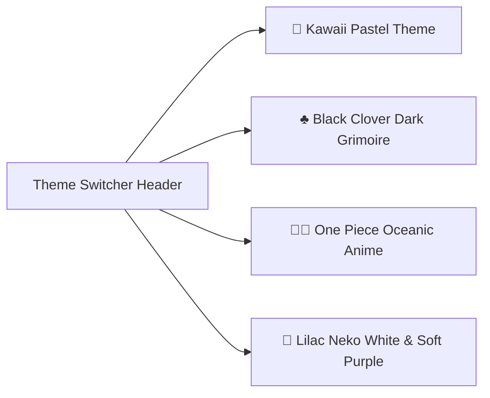

# Design System & Theme Engine — Aesthetic Expense Tracker

This document defines the complete visual language, design tokens, typography, multi-theme architecture, and 3D anime sticker system for the application.

---

## 1. Multi-Theme Engine

The app supports 4 distinct visual themes switchable dynamically with instant reactive updates across all components and navigation chrome:

### 1.1 Theme 1: 🌸 Kawaii Pastel (Cozy / Calming Aesthetic)
Designed with soft, soothing pastel tones, rounded corners, and gentle drop shadows.

- **Tokens**:
  - `bgPrimary`: `#ddebdc` (Soft Sage)
  - `bgSecondary`: `#eef5ec` (Light Sage Cream)
  - `bgCard`: `#ffffff` (Pure White)
  - `bgCardAlt`: `#faf7f2` (Warm Vanilla)
  - `primaryAccent`: `#f4aab9` (Pastel Blossom Pink)
  - `primaryAccentHover`: `#e899aa`
  - `primaryGreen`: `#85b885` (Mint Green)
  - `textMain`: `#2c352d` (Deep Slate Green)
  - `textMuted`: `#637365` (Muted Sage)
  - `borderSoft`: `#d3e2d2`
  - `borderPink`: `#f3c2cc`
  - `statusPendingBg`: `#ffe4e6`
  - `statusPendingText`: `#d9384e`
  - `statusCompletedBg`: `#d3f2db`
  - `statusCompletedText`: `#24783e`
- **Mascot Stickers**:
  - Home: `sticker_cat.jpg` (Cute Kitty Coin Purse)
  - Debit/Credit: `sticker_piggy.jpg` (Chubby Piggy Bank)
  - Wishlist: `sticker_gift.jpg` (Pastel Gift Box)
  - Account Vault: `sticker_lock.jpg` (Cute Shield Padlock)

---

### 1.2 Theme 2: ♣️ Black Clover (Dark Grimoire Anime Aesthetic)
Designed with high-contrast grimoire aesthetics, dark slate surfaces, and neon mana accents.

- **Tokens**:
  - `bgPrimary`: `#0b0e11` (Deep Grimoire Black)
  - `bgSecondary`: `#12161a` (Dark Slate Gray)
  - `bgCard`: `#1e252d` (Elevated Grimoire Card)
  - `bgCardAlt`: `#252e37` (Surface Dark)
  - `primaryAccent`: `#ff4d6d` (Anti-Magic Crimson)
  - `primaryGreen`: `#38ef7d` (Emerald Mana Green)
  - `textMain`: `#f1f5f9` (Bright Mana White)
  - `textMuted`: `#94a3b8` (Muted Steel)
  - `borderSoft`: `#2e3844`
  - `borderPink`: `#682937`
  - `statusPendingBg`: `#3e1b24`
  - `statusPendingText`: `#ff6b81`
  - `statusCompletedBg`: `#123821`
  - `statusCompletedText`: `#38ef7d`
- **Mascot Stickers**:
  - Home: `nero_bird.jpg` (Nero Anti-Magic Bird)
  - Debit/Credit: `nero_bulls.jpg` (Black Bulls Bullion)
  - Wishlist: `nero_grimoire.jpg` (Five-Leaf Grimoire)
  - Account Vault: `nero_secre.jpg` (Secre Swallowtail)

---

### 1.3 Theme 3: 🏴‍☠️ One Piece (Oceanic Pirate Gold Aesthetic)
Designed with ocean navy blues, pirate gold accents, and Straw Hat crimson highlights.

- **Tokens**:
  - `bgPrimary`: `#05080c` (Abyssal Ocean)
  - `bgSecondary`: `#0b1726` (Midnight Navy)
  - `bgCard`: `#1a2b3c` (Thousand Sunny Deck Card)
  - `bgCardAlt`: `#23384e` (Deep Blue Accent)
  - `primaryAccent`: `#ffd100` (Pirate Gold)
  - `primaryGreen`: `#00d26a` (Sea Foam Green)
  - `textMain`: `#f8fafc` (Clean White)
  - `textMuted`: `#8da2b5` (Muted Sky)
  - `borderSoft`: `#2a435d`
  - `borderPink`: `#6d5012`
  - `statusPendingBg`: `#401f1f`
  - `statusPendingText`: `#ff6b6b`
  - `statusCompletedBg`: `#0f3b2e`
  - `statusCompletedText`: `#00d26a`
- **Mascot Stickers**:
  - Home: `op_luffy.jpg` (Monkey D. Luffy Straw Hat)
  - Debit/Credit: `op_zoro.jpg` (Roronoa Zoro Three Swords)
  - Wishlist: `op_sunny.jpg` (Thousand Sunny Ship)
  - Account Vault: `op_chopper.jpg` (Tony Tony Chopper)

---

### 1.4 Theme 4: 🐾 Lilac Neko (White & Soft Purplish Aesthetic)
Designed around the chibi anime cat girl mascot with clean white surfaces, airy lavender undertones, and vibrant lilac purple accents.

- **Tokens**:
  - `bgPrimary`: `#f8f6fc` (Soft White with Lavender Tint)
  - `bgSecondary`: `#eeeaf8` (Delicate Lilac Surface)
  - `bgCard`: `#ffffff` (Pure Crisp White)
  - `bgCardAlt`: `#faf8ff` (Subtle Lilac White)
  - `primaryAccent`: `#9d72d6` (Pastel Lilac Purple)
  - `primaryAccentLight`: `#f0eaff` (Light Lavender Wash)
  - `primaryGreen`: `#48b884` (Calming Mint Emerald)
  - `textMain`: `#261e35` (Deep Lavender Charcoal)
  - `textMuted`: `#6d6380` (Dusty Lilac Slate)
  - `borderSoft`: `#e6e0f2`
  - `borderAccent`: `#d4c6ed`
  - `statusPendingBg`: `#fde8ec`
  - `statusPendingText`: `#d63353`
  - `statusCompletedBg`: `#e2f6ec`
  - `statusCompletedText`: `#238656`
- **Mascot Stickers**:
  - Home: `neko_home.jpg` (Chibi Anime Cat Girl Mascot)
  - Debit/Credit: `neko_debit.jpg` (Kitten Sleeping on Purple Piggy Bank)
  - Wishlist: `neko_wishlist.jpg` (Chibi Cat Girl with Glowing Purple Gift Box)
  - Account Vault: `neko_vault.jpg` (Chibi Cat Girl Vault Guardian with Cat Padlock)

---

## 2. Category Color Swatches

Each expense category maps to an expressive color token adapted per theme:

| Category | Emoji | Kawaii Theme Color | Black Clover Color | One Piece Color | Lilac Neko Color |
|---|---|---|---|---|---|
| Shopping | 🛍️ | `#f48295` | `#ff4d6d` | `#ffd100` | `#b07cd8` |
| Utilities | 🏠 | `#85b885` | `#38ef7d` | `#00a8e8` | `#7ca5d8` |
| Food & Dining | 🍔 | `#ffc285` | `#ffd166` | `#ff385c` | `#f59762` |
| Transport | 🚗 | `#64ad72` | `#2ec4b6` | `#f4a261` | `#60bfa0` |
| Coffee | ☕ | `#d85c72` | `#f78c6c` | `#e76f51` | `#c06ca8` |
| Entertainment | 🍿 | `#a685e2` | `#a685e2` | `#8338ec` | `#8b62cf` |

---

## 3. Typography Hierarchy

- **Header / Titles**:
  - *Kawaii*: `Fredoka` / Rounded Bold
  - *Black Clover*: `Cinzel` / Serif Bold
  - *One Piece*: `Luckiest Guy` / High-energy Heavy Sans
- **Body & Numerical Figures**:
  - `Nunito` / `System Rounded` (Weights: `400 Regular`, `600 SemiBold`, `700 Bold`, `800 ExtraBold`)
  - Formatted with thousand separators: `Rs. 124,000.00`.

---

## 4. Tactile & Micro-Interactions
- **Haptic Feedback**:
  - Tab Switch: Light impact (`Haptics.impactAsync(Haptics.ImpactFeedbackStyle.Light)`).
  - PIN Button Tap: Medium impact (`Haptics.ImpactFeedbackStyle.Medium`).
  - Success Actions (Adding expense, completing debt repayment): Success notification (`Haptics.notificationAsync(Haptics.NotificationFeedbackType.Success)`).
- **Spring Animations**:
  - Floating 3D sticker slight bobbing / pulse.
  - Modal bottom sheet entry / exit with Reanimated springs.
  - Number counter transitions when balance updates.
