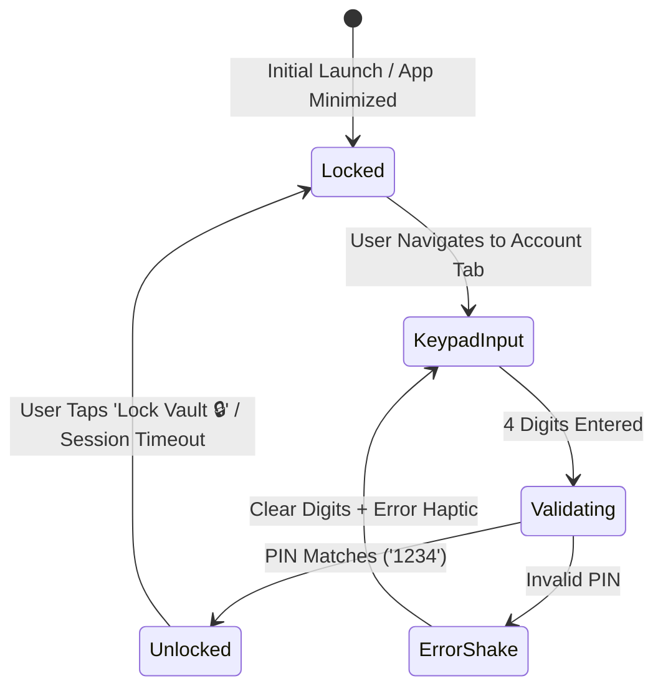

# Security & PIN Vault Specification — Aesthetic Expense Tracker

This document outlines the authentication, privacy protection, and PIN lock architecture for securing the Account Management screen.

---

## 1. Security Threat Model & Privacy Goals
Financial account balances and internal bank routing are sensitive personal data. The Account Management tab enforces a local PIN gatekeeper to prevent shoulder surfing or unauthorized access when handing the device to others.

---

## 2. PIN Lock Flow & State Machine

---

## 3. UI Keypad Specification
- **Aesthetic**: Custom rounded circular digit buttons with tactile haptic feedback on each press.
- **PIN Dot Indicator**: 4 pulsating bubbles that fill up with theme accent colors as numbers are pressed.
- **Biometric Option**: Optional FaceID / TouchID trigger where supported via Expo Local Authentication.
- **Relock Control**: A persistent "Lock Vault 🔒" button in the upper right header allowing instant re-locking.
- **Account Balance Masking**: An eye icon `👁️` toggle allows obscuring balance numbers (`Rs. ••••••`) even while inside the unlocked view.
